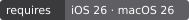
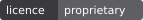
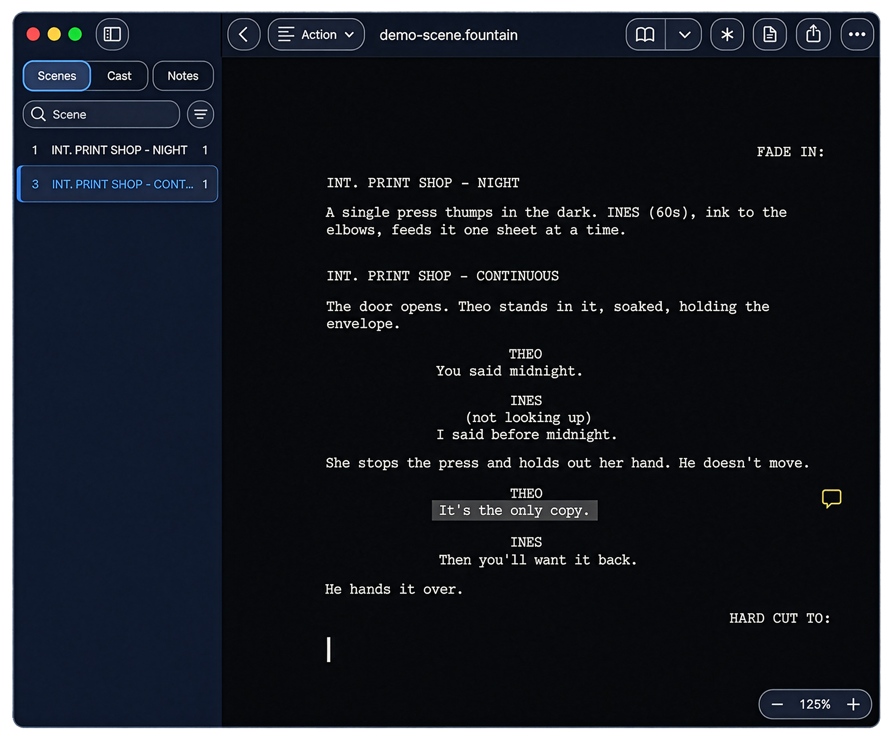

<p align="center">
  
</p>

<h1 align="center">eDraft</h1>

<p align="center">
  A free (preview) screenwriting app for iPhone, iPad and Mac.<br>
  <em>No account. No eDraft server. Your scripts are files on your devices or in your own iCloud Drive.</em>
</p>

<p align="center">
  <a href="https://apps.apple.com/app/edraft/id6816992261"></a>
  <a href="https://apps.apple.com/app/edraft/id6816992261"></a>
  <a href="https://apps.apple.com/app/edraft/id6816992261"></a>
  
  
  <a href="LICENSE"></a>
</p>

<p align="center">
  <a href="https://apps.apple.com/app/edraft/id6816992261">App Store</a> ·
  <a href="https://edraft.xyz">edraft.xyz</a> ·
  <a href="https://edraft.xyz/help">Help</a> ·
  <a href="https://edraft.xyz/privacy">Privacy</a> ·
  <a href="docs/research.md">Research</a>
</p>

<p align="center">
  
</p>

## 1. Introduction

eDraft formats your screenplay as you type. It opens and saves Final Draft and
Fountain files, so a script can move between eDraft and other screenwriting
software.

During production, scene numbers, page numbers and revision colours let everyone
refer to the same part of a script. eDraft is built to keep them. When it saves
a Final Draft file, it rewrites only the paragraphs you changed; everything else
in the file, including data eDraft has no screen for, is written back as it was.

eDraft 2.2 is free (preview) on the App Store; see the
[FAQ](docs/faq.md#is-edraft-free). One download gives you the app for iPhone,
iPad and Mac. Version 2.2 brings eDraft to iPad and gives every scene in the
Navigator a menu of its own. Version 2.1 gave each person's notes a colour of
their own and added labels. See the [Changelog](CHANGELOG.md).

## 2. Key features

- **Final Draft and Fountain, both ways.** Open, edit and save `.fdx` and
  Fountain files in their own format.
- **Notes on a single word.** Select a word or a phrase and add a note. The note
  stays on those words as you write, and it is kept in eDraft, Fountain and Final
  Draft files.
- **One colour per person, and labels.** Everyone whose notes carry their name
  keeps one colour of their own, on the page and in the Navigator. Give a note a
  label, such as "Rewrite", and show only the notes with one name or one label.
- **A menu for every scene.** In the Navigator, touch and hold a scene (iPhone
  and iPad) or Control-click it (Mac) to copy, duplicate or delete it, or add a
  note to it. In a Final Draft script, omit a scene and restore it there.
  Details shows a scene's length, running time, word count, characters and
  notes.
- **Ideas.** On iPhone or iPad, tap the microphone in the library, or while you
  read a script, and speak. eDraft saves the recording first. Then, if your
  device has a speech model for your language, it writes down the words. Later,
  place the idea in a script as a note, action, dialogue or a new scene, on the
  iPhone, the iPad or the Mac (View > Ideas). Ideas reach your other devices
  through your own iCloud. You can also ask Siri: "Add an idea in eDraft".
- **German.** When your iPhone, iPad or Mac is set to German, menus, windows,
  messages and the Mac's Help are in German. INNEN. and
  AUSSEN. start a scene heading, and the writing suggestions offer them. An
  eDraft script can print (MEHR) and (FORTS.) instead of (MORE) and (CONT'D). A
  new installation in a German-speaking region (Germany, Austria, Switzerland,
  Liechtenstein, Luxembourg) starts on A4 paper.
- **Revisions.** Mark a draft when you send your script out. From then on, an
  asterisk marks each changed line, on screen, in the PDF and in print. Revision
  colours follow the order used in production: after Goldenrod come Buff, Salmon
  and Cherry.

## 3. Get started

1. Download eDraft from the [App Store](https://apps.apple.com/app/edraft/id6816992261).
2. Open the [example scene](examples/demo-scene.fdx) from this repository, or
   start a new screenplay.
3. Write, then export a PDF or save as Final Draft or Fountain.

The [Help pages](https://edraft.xyz/help) explain each feature.

## 4. At a glance

| | |
|---|---|
| **Price** | Free (preview) |
| **Platforms** | iPhone, iPad and Mac, one App Store download |
| **Version** | 2.2 (2026-11-14) |
| **Requires** | iOS 26 or later · iPadOS 26 or later · macOS 26 or later |
| **In test** | A version for Apple Vision Pro |
| **Languages** | English, German |
| **Account** | None |
| **Where scripts live** | Files on your devices, or in your own iCloud Drive |
| **Open and save** | Final Draft (`.fdx`), Fountain, plain text, eDraft's own document (`.draft`) |
| **Export** | PDF, Final Draft, Fountain, plain text; on iPhone and iPad also an eDraft document and rich text (RTF) |
| **On iPhone and iPad** | Turn a PDF or a photo of a printed page into a new script (the text is read from the page) |
| **Not yet supported** | Word (`.docx`) files — planned |

## 5. Verification notes

These were counted for version 2.2.

| What | Result |
|---|---|
| Interface strings with a German translation | 983 of 983 (counted) ¹ |
| Swift tests in the app's code | 3,861 in 348 files (counted, not run for this page) ² |
| The example `.fdx`, opened and saved without edits | Same file, byte for byte: 2,528 bytes in, 2,528 bytes out ³ |

¹ Counted in the string catalogs of the code that shipped as 2.2, Siri phrases
included. The Mac's Help is a German book of its own and is not counted here.<br>
² XCTest methods and Swift Testing functions in the code that shipped as 2.2.<br>
³ Checked with the code that shipped as 2.2, through the open-and-save path the
app uses. You can check it yourself: see *Example*.

## 6. Example

The [`examples/`](examples) folder holds a short original scene in two formats:

- [`demo-scene.fdx`](examples/demo-scene.fdx) — Final Draft format, with a note
  and an omitted scene.
- [`demo-scene.fountain`](examples/demo-scene.fountain) — the same scene in
  Fountain. Fountain has no way to mark an omitted scene, so scene 2 is absent
  and the numbering keeps the gap (1, 3).

Both files, as they stand in this repository:

```text
30cca645c69f9f5f59eaff3b62543b4ff9b1ffaf4463d0bfc1c412f791d09b86  demo-scene.fdx
153160c3cbdd8319e9641b487dda7b1d957a59f45457f58c88a90437edb0eaf3  demo-scene.fountain
```

To check the round trip yourself: download `demo-scene.fdx`, open it in eDraft on
the Mac, choose File > Save without changing anything, then run
`shasum -a 256 demo-scene.fdx` on the saved file. The checksum is the same as
above.

## 7. Principles

Nine principles guide the work. When a principle and an easier implementation
disagree, the principle wins. Three of them:

- **Nothing is lost silently.** When something cannot be kept, the app says so.
- **The writer's text is theirs.** The app does not rewrite a writer's words to
  fit its own model.
- **Measure; do not assume.** Where eDraft has to match another app, we check
  what that app actually writes.

Read all nine in the [design principles](docs/design-principles.md).

## 8. Research

The design research behind eDraft is published as a report:
*The Writer Never Formats: What belongs in a screenplay editor, and where it
should sit* (version 1.0, 16 November 2026,
[doi:10.5281/zenodo.24285828](https://doi.org/10.5281/zenodo.24285828)). It asks
what belongs at the centre of a screenplay editor, what should be optional, and
what should stay out. The report is licensed CC BY 4.0. The
[research page](docs/research.md) has the abstract, what the report does not
claim, and how to cite it.

## 9. Documentation

- [**Product overview**](docs/product-overview.md) — what eDraft is, and who it is for
- [**Design principles**](docs/design-principles.md) — the rules the work follows
- [**Research**](docs/research.md) — the design research report, and how to cite it
- [**Roadmap**](docs/roadmap.md) — what works, what is in progress, what is planned
- [**FAQ**](docs/faq.md) — common questions
- [**Development record**](record) — what was built and decided, phase by phase
- [**Changelog**](CHANGELOG.md) — what changed in each release

## 10. Support and contact

- **A bug, or something wrong in these documents** — open an
  [issue](https://github.com/yasirdora/edraft/issues) with the bug report form.
- **A question or an idea** — [Discussions](https://github.com/yasirdora/edraft/discussions)
- **A security issue** — please report it privately; see [SECURITY.md](SECURITY.md).
- **Anything else, including research licences** — [edraft@ysr.design](mailto:edraft@ysr.design)

## 11. This repository and licence

This repository holds eDraft's documentation, example files and images. The
app's source code is private, so there is no build to run and no code to send a
pull request against. Contributions here are documentation corrections and bug
reports (see [CONTRIBUTING.md](CONTRIBUTING.md)). The research report has its
own licence, CC BY 4.0 (see [Research](docs/research.md#licence)).

The contents of this repository are proprietary. Copyright © 2025–2026 Yasir
Dora. All rights reserved. See [LICENSE](LICENSE) for what you may do with the
example files.

<p align="center">
  <i>Made by a writer, for writers.</i>
</p>
