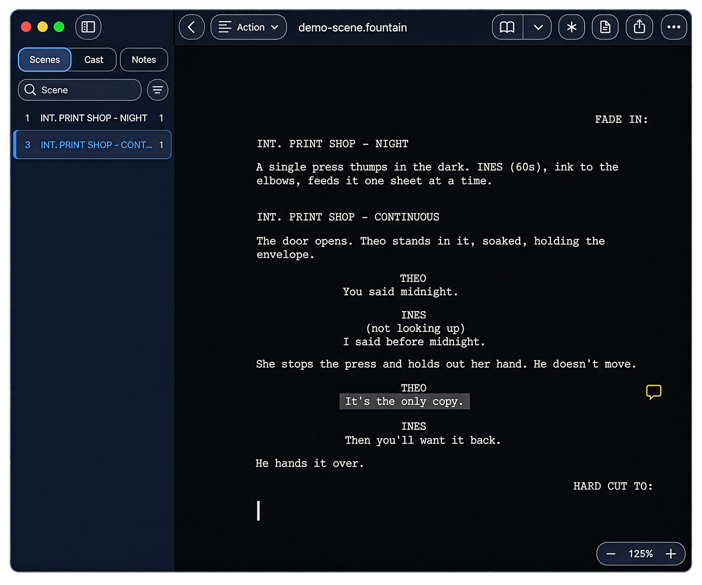

<p align="center">
  
</p>

<h1 align="center">eDraft</h1>

<p align="center">
  A screenwriting application that keeps the script on the writer's machine.<br>
  <em>No account. No eDraft server. No connection needed to write, open or save.</em>
</p>

<p align="center">
  <a href="https://apps.apple.com/app/edraft/id6816992261">Download on the App Store</a> ·
  <a href="https://edraft.xyz">edraft.xyz</a>
</p>

<p align="center">
  
</p>

## What eDraft is

A screenplay is not only writing. Once a production starts it becomes a shared
document with addresses in it — scene numbers, page numbers, revision colours —
and those addresses are what the rest of the department works from.

Most tools lose the parts of a file they cannot model. eDraft does not. Opening
a file and saving it without edits returns the original bytes; editing one line
changes that line and leaves everything else alone, including production data
the application has no interface for yet.

The [product overview](docs/product-overview.md) sets out the problem and the
approach in full.

---

## What it does

- **Writing** — A screenplay editor that formats as you type: scene headings,
  action, character cues, dialogue, parentheticals, transitions.
- **Local files** — Scripts stay ordinary files on your machine, in formats
  other software can open.
- **Interchange** — Reads and writes the formats used in screenwriting and
  production, including Final Draft documents and Fountain, with import from
  common word-processor and plain-text sources.
- **Notes** — Notes stay attached to the text they refer to, and survive a round
  trip through supported software.
- **Production data** — Scene numbering, revisions and omitted scenes are
  production concepts the application knows about, so they survive editing and
  interchange.

---

## Formats

| Direction | Formats |
|---|---|
| Write and read | Final Draft documents (`.fdx`), Fountain, eDraft's own document format |
| Export | PDF, Final Draft, Fountain, Word (`.docx`), plain text |
| Import | Final Draft, Fountain, Word (`.docx`), plain text, PDF produced by eDraft |
| Read back | A PDF eDraft produced carries its script with it, and reopens exactly |

Interchange is a design requirement rather than an export menu: a script passing
between eDraft and other software should arrive intact in both directions.

---

## Platforms

| Status | Platforms |
|---|---|
| On the App Store (preview) | [macOS](https://apps.apple.com/app/edraft/id6816992261) |
| In development | iPadOS, iOS, Web, Chrome extension |
| Planned | Windows, Linux, Android |

See the [roadmap](docs/roadmap.md) for current and planned work.

---

## Getting eDraft

**[eDraft for macOS is on the App Store as a preview](https://apps.apple.com/app/edraft/id6816992261)**,
and it is free. It requires macOS 26 or later.

The other platforms are in development, and the application is not distributed
from this repository. [edraft.xyz](https://edraft.xyz) is the product page.

Screenwriting professionals, educators, researchers and developers interested in
a research licence or in collaborating are welcome to get in touch:
[edraft@ysr.design](mailto:edraft@ysr.design).

---

## Example

The [`examples/`](examples) directory holds a short original scene in two
formats:

- [`demo-scene.fdx`](examples/demo-scene.fdx) — Final Draft format, including a
  note and an omitted scene.
- [`demo-scene.fountain`](examples/demo-scene.fountain) — the same scene in
  Fountain. Fountain has no equivalent representation for an omitted scene, so
  scene 2 is absent while the numbering keeps the gap.

Both files, as they stand in this repository:

```text
30cca645c69f9f5f59eaff3b62543b4ff9b1ffaf4463d0bfc1c412f791d09b86  demo-scene.fdx
153160c3cbdd8319e9641b487dda7b1d957a59f45457f58c88a90437edb0eaf3  demo-scene.fountain
```

Open `demo-scene.fdx` in the Mac app, save it without making changes, and the
checksum should match.

---

## Principles

Nine principles decide arguments in this project: when a principle and a
convenient implementation disagree, the principle wins. Three of them:

- **Nothing is lost silently.** When something cannot be preserved, the
  application says so. A loss the writer is told about is a decision they can
  make; a loss they discover later is a defect.
- **The writer's text is theirs.** The application does not rewrite a writer's
  words to suit its own model.
- **Measure; do not assume.** Where behaviour has to match another
  application's, it is established by examining what that application actually
  produces, not by reasoning about what it probably does.

The [design principles](docs/design-principles.md) carry all nine.

---

## Documentation

- [**Product overview**](docs/product-overview.md) — what eDraft is, and who it
  is for
- [**Design principles**](docs/design-principles.md) — the rules the work
  follows, and why they decide arguments
- [**Roadmap**](docs/roadmap.md) — what works, what is in progress, what is
  planned
- [**FAQ**](docs/faq.md) — common questions
- [**Development record**](record) — what was built and what was decided, phase by phase

---

## Support

- **A bug, or something wrong in these documents** — open an
  [issue](https://github.com/yasirdora/edraft/issues) using the bug report form.
- **A question, or an idea** —
  [Discussions](https://github.com/yasirdora/edraft/discussions)
- **A security issue** — please report it privately. See
  [SECURITY.md](SECURITY.md).
- **Anything else, including research licences** —
  [edraft@ysr.design](mailto:edraft@ysr.design)

---

## Contributing

The application source is private, so there is no build to run and no code to
send a pull request against. Contributions here are documentation corrections
and bug reports.

See [CONTRIBUTING.md](CONTRIBUTING.md) before opening an issue.

---

## This repository

This repository holds eDraft's documentation, example files and images. The
application source code, the research materials and the internal design
documents are private.

---

## Licence

The contents of this repository are proprietary. Copyright © 2025–2026 Yasir
Dora. All rights reserved.

See [LICENSE](LICENSE) for the terms.
